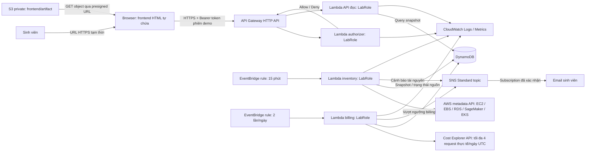

# Tuần 1 — Kiến trúc ops dashboard Learner Lab

Trạng thái: nền tảng VPC/S3 tuần 1 đã triển khai; collector/API còn là thiết kế cho tuần 2–3. Vùng hạ tầng chính: `us-east-1`; phạm vi inventory dự kiến: `us-east-1`, `us-west-2`. ID tài nguyên thật ở [biên bản triển khai](07-deployment-record.md).

Thành viên: Lê Minh Huy — 24110019. Tag tài nguyên do dự án tạo: `Project=learnerlab-ops`, `Owner=24110019`. LLM/AI (ChatGPT) đã triển khai và xác minh VPC/S3 trong Learner Lab `213858341631` ở `us-east-1`; chưa triển khai pipeline. Quyền các dịch vụ pipeline vẫn cần kiểm tra khi làm tuần 2–3.

## 1. Luồng tổng thể

VPC nằm ngoài đường dữ liệu này: có thể là minh chứng nền tảng mạng tuần 1. Template nền tảng có hai subnet với route Internet Gateway nhưng tắt tự cấp public IPv4; không NAT Gateway, Elastic IP hoặc EC2. Collector đọc AWS API của tài nguyên có sẵn; không cần kết nối cổng database hoặc Kubernetes endpoint.

## 2. Các thành phần và lịch

| Thành phần | Trách nhiệm | Cấu hình thiết kế ban đầu |
|---|---|---|
| `inventory-collector` | Đọc metadata hai vùng và ghi snapshot/trạng thái | `rate(15 minutes)` trong thời gian demo; bật/tắt lịch theo phiên làm việc |
| `billing-collector` | Đọc CE và đánh giá ngưỡng chi phí | `cron(0 0,12 * * ? *)`: 00:00/12:00 UTC, tức 07:00/19:00 Việt Nam |
| `read-api` | Trả snapshot/cache cho frontend | Chỉ GET, không tạo/dừng/xóa tài nguyên và không gọi CE |
| `demo-authorizer` | Bảo vệ route dữ liệu | Lambda authorizer HTTP API, payload 2.0, simple responses, cache TTL 0 |
| DynamoDB | Inventory, billing, counters, alert state | Một bảng on-demand trong vùng chính; không Global Table/GSI ban đầu |
| S3 | HTML tĩnh tự chứa và artifact nền tảng | Private, Block Public Access; Content-Type `text/html` cho frontend |
| SNS | Email cảnh báo | Standard topic, chỉ người nhận đã xác nhận |
| CloudWatch | Log và metric vận hành | Đề xuất retention 7 ngày cho log demo; mức này cần xác minh quyền khi triển khai |

Scheduled rules dùng UTC; đây là lựa chọn thiết kế cho lab, dù AWS khuyến nghị Scheduler cho ứng dụng mới. Chỉ dùng rule sau khi kiểm tra quyền và giới hạn môi trường. [Scheduled rules](https://docs.aws.amazon.com/eventbridge/latest/userguide/eb-create-rule-schedule.html).

EventBridge gọi Lambda qua resource policy với principal `events.amazonaws.com` và `SourceArn` của đúng rule. API Gateway cũng được cấp quyền invoke đúng function bằng resource policy. Không cần tạo IAM execution role mới cho những đường gọi này. Execution role của các Lambda là `LabRole` hiện có. [EventBridge target permissions](https://docs.aws.amazon.com/eventbridge/latest/userguide/eb-use-resource-based.html), [HTTP API Lambda authorizer permissions](https://docs.aws.amazon.com/apigateway/latest/developerguide/http-api-lambda-authorizer.html).

## 3. Thiết kế đọc dữ liệu và lỗi

1. Inventory chạy hai Region được phép, mỗi adapter tự phân trang. Có thể chạy song song từng nguồn với giới hạn concurrency; ghi request ID khi lỗi, không ghi toàn bộ credential/header.
2. Mỗi lần thu thập tạo `snapshotId`, `collectedAt` UTC, nguồn/Region/status và tài nguyên chuẩn hóa. Ghi từng resource thành item riêng để tránh một snapshot lớn nằm trong một item.
3. Chỉ đánh dấu một nguồn là `ok` khi đã đọc đủ trang. `AccessDenied` là `unavailable`; lỗi mạng/throttling là `error`; cắt giới hạn trang là `partial`.
4. API đọc bản mới nhất cùng trạng thái nguồn. Nếu nguồn lỗi, giữ lần thành công gần nhất cho lịch sử và đánh dấu `stale`; không thay số liệu bằng một tập rỗng.
5. Kết quả `ok` với danh sách rỗng mới có nghĩa là 0 tài nguyên trong phạm vi đã kiểm kê. Thiếu quyền hoặc chưa thu thập thì `count=null`.
6. Inventory trễ hơn 30 phút có nhãn “dữ liệu cũ”. Billing có mốc lấy riêng; ngưỡng độ cũ 36 giờ là lựa chọn của dự án và không làm biến mất giới hạn độ trễ dữ liệu upstream.

API metadata không đảm bảo trạng thái tức thì sau mọi thay đổi. Frontend hiển thị thời điểm quan sát, không khẳng định tài nguyên còn chạy tại giây người dùng đang xem. [EC2 eventual consistency](https://docs.aws.amazon.com/AWSEC2/latest/APIReference/API_DescribeInstances.html).

## 4. Mô hình dữ liệu dự kiến

Khóa `PK`, `SK` kiểu string; giữ timestamp chuẩn ISO 8601 UTC cho truy vấn sắp xếp theo thời gian. `expiresAt` là epoch seconds để dùng TTL.

| Loại item | Ví dụ PK | Ví dụ SK | Dữ liệu chính |
|---|---|---|---|
| Inventory manifest | `INV#<account>#<region>` | `SNAP#<timestamp>#META` | snapshotId, trạng thái mỗi adapter, tổng số, collectedAt |
| Inventory resource | `INV#<account>#<region>` | `SNAP#<timestamp>#RES#EC2#<id>` | service, id/arn, state, type, tags, rawSubset |
| Con trỏ mới nhất | `INV#<account>#<region>` | `LATEST` | Manifest mới nhất hoàn tất; API theo snapshotId để Query đúng prefix |
| Billing snapshot | `BILL#<account>` | `SNAP#<timestamp>` | day/service/amount/unit, Estimated, khoảng ngày, requestCount |
| Billing mới nhất | `BILL#<account>` | `LATEST` | Tham chiếu snapshot hoàn chỉnh mới nhất, latestAttempt/status |
| Ngân sách CE request | `CE#<account>#<dateUTC>` | `BUDGET` | attempts, lock/lease, expiresAt |
| Trạng thái cảnh báo | `ALERT#<account>` | `<ruleId>#<period>` | trạng thái, ngưỡng, lastSentAt, eventId |

`rawSubset` chỉ giữ trường cần thiết; không lưu secret, token, password hoặc nội dung từ database. Billing snapshot lớn cũng phải tách thành item theo ngày/dịch vụ, không cố nhét mọi lịch sử vào một item. Đề xuất giữ snapshot 30 ngày; TTL chỉ hỗ trợ dọn dữ liệu, không thay cho giới hạn thời gian trong Query. Dữ liệu đã hết hạn có thể còn xuất hiện trước khi TTL xóa. [DynamoDB TTL](https://docs.aws.amazon.com/amazondynamodb/latest/developerguide/TTL.html).

Con trỏ `LATEST` chỉ cập nhật sau khi viết xong các item của snapshot. Dùng idempotency key từ lần chạy/snapshot để retry không tạo hai bộ dữ liệu khác nhau. Hai Region kiểm kê ghi cùng bảng vùng chính; không cần tạo bản sao DynamoDB giữa vùng.

## 5. Billing và kiểm soát request

Request CE dùng endpoint vùng `us-east-1`, thống kê tài khoản theo `SERVICE`, không lọc bỏ Region để tránh bỏ sót chi phí toàn cục/chi phí khác đã ghi nhận. Phần inventory vẫn chỉ thu thập hai Region được phép. Giao diện ghi rõ phạm vi chi phí toàn tài khoản, phạm vi inventory hai Region; không giả định chi phí của riêng tài nguyên gắn Project khi chưa có cost allocation tags. [Cost Explorer endpoint](https://docs.aws.amazon.com/general/latest/gr/billing.html).

Mỗi lượt đọc truy vấn từ ngày đầu tháng UTC đến ngày hiện tại UTC + 1 ngày, End không bao gồm. Ngày đang diễn ra có thể chưa có hoặc chưa đủ billing; hiển thị `Estimated` và khoảng dữ liệu thay vì giả rằng số tiền đã chốt. [GetCostAndUsage date semantics](https://docs.aws.amazon.com/aws-cost-management/latest/APIReference/API_GetCostAndUsage.html).

Giới hạn 4 request CE thực tế/ngày UTC là yêu cầu thiết kế cứng: đặt SDK CE `total_max_attempts=1`, quản lý retry trong collector; reserve counter nguyên tử trước mỗi trang/retry. Scheduled invocation trùng phải khóa bằng lease/conditional write; ngày/lock hết hạn vẫn phải kiểm tra bằng logic vì TTL không xóa ngay. Không có lượt gọi CE từ API hay frontend. Khi bị giới hạn, lưu lần thử `partial`/`unavailable` và giữ bản billing hoàn chỉnh trước đó.

Billing không phải số dư credit Learner Lab và không đảm bảo phát hiện chi phí tăng trong vài phút. Dùng inventory để nhắc tài nguyên hoạt động; cảnh báo billing chỉ có ý nghĩa theo dữ liệu đã ghi nhận. Không cộng ước tính hourly vào tổng CE, không vẽ nguồn thiếu quyền thành đường 0 USD.

## 6. API và frontend

| Route dự kiến | Phản hồi |
|---|---|
| `GET /summary` | Trạng thái nguồn, Region, tổng tài nguyên theo nguồn, thời điểm lấy, billing cached |
| `GET /resources?region=...&service=...` | Tài nguyên và nhãn freshness, có phân trang |
| `GET /costs?from=YYYY-MM-DD&to=YYYY-MM-DD` | Chuỗi billing đã lưu, phạm vi ngày/đơn vị/Estimated |
| `GET /alerts` | Cảnh báo và trạng thái gửi từ snapshot |

Giới hạn tham số Region/service/ngày, độ dài trang và khoảng lịch sử; trả lỗi 400 cho đầu vào sai. Không cung cấp route POST “collect now” từ frontend. API là HTTP API tích hợp Lambda; CORS và authorization là hai chức năng riêng. [HTTP API](https://docs.aws.amazon.com/apigateway/latest/developerguide/http-api.html).

Frontend chính là một HTML tự chứa CSS/JS/biểu đồ, lưu S3 private. Người dùng mở URL HTTPS presigned ngắn hạn (đề xuất 1 giờ hoặc ngắn hơn phiên lab); tài nguyên CSS/JS không được dựa vào relative URL tới các object private chưa ký. Không dùng thư viện remote bắt buộc cho demo và không chứa secret trong HTML. Presigned URL là quyền truy cập tạm thời, phải tránh đưa nguyên URL vào Git/ảnh công khai; credentials tạm thời hết hạn có thể làm URL hết hạn sớm. [S3 presigned URL expiration](https://docs.aws.amazon.com/AmazonS3/latest/userguide/using-presigned-url.html).

**Xác thực phù hợp bài demo:** trước khi xuất dữ liệu thật ở tuần 2, tạo bearer token ngẫu nhiên đủ mạnh cho một phiên demo, cấu hình token/hash và thời điểm hết hạn ở Lambda authorizer dùng `LabRole`. Sinh viên nhập token vào frontend; JS giữ trong memory, gửi `Authorization: Bearer ...`; không lưu localStorage, không ghi log, không đưa vào URL hoặc frontend build. Authorizer phải so sánh an toàn và kiểm tra hạn; `TTL=0` tránh cache quyền sau khi đổi token. Đây là một secret dùng chung cho nhóm, không phải hệ thống tài khoản/per-user audit. Bổ sung quy trình xoay token, test thu hồi/hết hạn và log redaction tuần 3; bảo vệ route phải có ngay trước demo dữ liệu thật. API key không thay thế xác thực. [Lambda authorizer](https://docs.aws.amazon.com/apigateway/latest/developerguide/http-api-lambda-authorizer.html).

Nếu lab không cho tạo authorizer/resource permission, giữ API dữ liệu chưa public và ghi rõ thiếu quyền để thống nhất phương án với giảng viên. Không chuyển route dữ liệu thật thành `NONE`. Lựa chọn JWT/Cognito hoặc CloudFront chỉ bổ sung nếu đã xác minh dịch vụ/quyền và vẫn tuân thủ không tạo IAM role.

CORS cho phép đúng origin object HTTPS: `https://<bucket>.s3.us-east-1.amazonaws.com` (xác minh hostname thực tế của URL), method `GET, OPTIONS`, headers `Authorization, Content-Type`, `allowCredentials=false`. Query string của presigned URL không phải một phần origin. Không dùng `*` hoặc `Origin: null` để né lỗi. HTTP API xử lý OPTIONS preflight khi có CORS; không gắn authorizer vào preflight. Nếu dùng `$default` route có authorizer, cần route OPTIONS không auth theo tài liệu; ưu tiên các GET route rõ ràng. [HTTP API CORS](https://docs.aws.amazon.com/apigateway/latest/developerguide/http-api-cors.html).

Bucket tuần 1 giữ private. S3 static website endpoint yêu cầu public-read và không có HTTPS; nó không phù hợp để nhập token hoặc trả dữ liệu vận hành thật. Nếu giảng viên bắt buộc tên gọi “S3 website hosting”, chốt cách phục vụ frontend qua HTTPS trước khi công bố, hoặc thống nhất demo private S3 presigned như sơ đồ. [S3 website versus REST endpoint](https://docs.aws.amazon.com/AmazonS3/latest/userguide/WebsiteEndpoints.html).

## 7. Cảnh báo và quyền

Ngưỡng đề xuất là cấu hình, chưa phải ngân sách được người dùng chốt: tổng billing tháng vượt một số USD; tài nguyên active thiếu tag; inventory không cập nhật; số EC2/vCPU/EBS vượt giới hạn đề bài. Không tự dừng hoặc xóa tài nguyên được quan sát. SNS gửi tối đa một lần khi chuyển từ bình thường sang vượt ngưỡng trong kỳ; lần publish lỗi được retry có mã event để nhận biết trùng.

| Thành phần | Quyền chức năng cần xác minh trong LabRole/phiên lab |
|---|---|
| Collector inventory | List/Describe EC2/EBS/instance types, RDS, SageMaker, EKS; ghi/query DynamoDB; SNS Publish; ghi log |
| Collector billing | `ce:GetCostAndUsage`; counter/lock/snapshot DynamoDB; SNS Publish; ghi log |
| Read API | DynamoDB GetItem/Query; ghi log |
| Authorizer | Đọc cấu hình token/hash cục bộ và ghi log đã lọc; không cần gọi IAM/CE |
| Người triển khai | Tạo/cấu hình tài nguyên được phép; `iam:PassRole` cho LabRole; resource-based `lambda:AddPermission`; thao tác S3 |

Bảng mô tả nhu cầu chức năng, không phải yêu cầu tạo policy/role mới. Do đề bài bắt buộc chung `LabRole`, mức cô lập quyền giữa function phụ thuộc quyền role có sẵn; ghi nhận giới hạn này trong báo cáo. Không khẳng định least privilege chỉ vì function thực tế gọi ít API.

## 8. Nền tảng tuần 1 và đường sang tuần 2

Trong tuần 1 đã xác minh phiên Lab/vùng/LabRole, tạo VPC hai subnet/IGW/route và bucket S3 riêng tư có tag, rồi lưu minh chứng. Chưa upload object vào bucket; có thể thực hành ở tuần sau khi bắt đầu triển khai frontend/artifact. Không cần tạo Lambda collector, API công khai, DynamoDB, SNS/email hoặc tài nguyên EC2/RDS/EKS/SageMaker chỉ để tick tuần 1.

Sang tuần 2: triển khai DynamoDB và collector inventory trước; kiểm tra lỗi quyền từng adapter; chạy billing giới hạn request nếu CE được phép; triển khai read API và authorizer trước khi mở dashboard dữ liệu thật; dựng frontend tĩnh lên S3; kiểm thử một luồng thực tế từ snapshot đến UI. Sang tuần 3: tích hợp cảnh báo, kiểm thử bảo mật, CloudWatch và tự động hóa phù hợp quyền lab.

Những điểm chưa xác minh phải tiếp tục nằm trong checklist: quyền CE và các adapter, ngân sách ứng dụng, recipient SNS, permission API authorizer, yêu cầu public hosting của giảng viên. Sơ đồ thể hiện cả nền tảng tuần 1 đã chạy và pipeline tuần 2–3 dự kiến; không phải ảnh chụp hạ tầng toàn hệ thống đang chạy.
