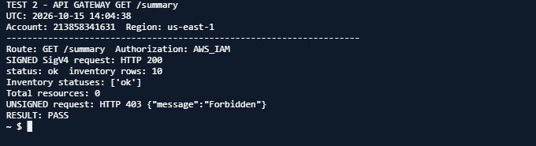
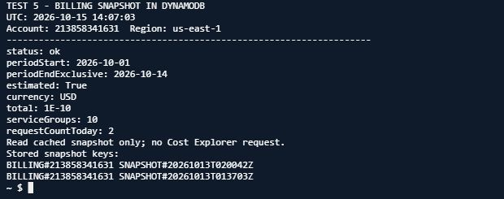

# Tuần 2 — Triển khai chức năng lõi và kiểm thử

Theo báo cáo ngày 15/10/2026, các chức năng lõi đã được triển khai và kiểm thử trên AWS Learner Lab. Tài nguyên chính ở `us-east-1`, dùng `LabRole` có sẵn. Báo cáo Word được nộp riêng qua hệ thống môn học; repo có worklog và ảnh kiểm thử chọn lọc.

## Thành phần đã triển khai

- **Lambda:** `inventory-core`, `billing-collector`, `read-api`, `threshold-alert`. Worklog cũng ghi một Lambda `ec2-collector` là phép thử sớm ngày 11/10; luồng kiểm kê hiện tại dùng `inventory-core`.
- **DynamoDB:** `learnerlab-ops-week2-snapshots`, `PAY_PER_REQUEST`, lưu snapshot tài nguyên và chi phí.
- **API Gateway:** HTTP API `qvpnt8h5yh`, route `GET /summary`, stage `$default`, xác thực `AWS_IAM`.
- **S3:** `learnerlab-ops-week2-dashboard-213858341631`; `index.html` riêng tư, mã hóa SSE-S3 và đủ bốn cờ Block Public Access.
- **EventBridge:** lịch kiểm kê mỗi 6 giờ; billing lúc 02:00 UTC; kiểm tra ngưỡng lúc 02:10 UTC. Ba rule được ghi nhận `ENABLED`.
- **SNS:** topic cảnh báo có email subscription đã xác nhận. Người nhận xác nhận đã nhận thư thử ngày 13/10; địa chỉ email không được đưa vào repo công khai.
- **Cost Explorer:** snapshot billing có cờ `estimated=true`; diễn giải đầy đủ ở [bảng nguồn dữ liệu](../data-sources.md).

## Kiểm thử thu thập và lưu trữ

Lambda kiểm kê trả HTTP 200, không có `FunctionError`. Snapshot DynamoDB có đủ 10 tổ hợp (5 nhóm dịch vụ × 2 Region), mỗi dòng `status=ok`, `count=0`. Đây là trạng thái tại thời điểm chụp và trong phạm vi tài nguyên đã hỗ trợ.

Các thao tác `PutItem`, `GetItem`, `Query`, `DeleteItem` trả HTTP 200; bản ghi tạm được xóa sau khi kiểm tra.

## Kiểm thử API và giao diện

Yêu cầu `GET /summary` có chữ ký SigV4 trả HTTP 200; yêu cầu không ký trả HTTP 403. Giao diện S3 hiển thị JSON thật đã nạp thủ công; trang chưa tự gọi API do route giữ `AWS_IAM`.

## Kiểm thử S3 và đối chiếu chi phí

`index.html` tồn tại, `HEAD` trả HTTP 200 với danh tính được phép. Bucket giữ riêng tư, mã hóa AES256 và bật đủ bốn lựa chọn Block Public Access.

Snapshot ghi `1E-10 USD` (`0.0000000001 USD`), `estimated=true`, cho kỳ `2026-10-01` đến trước `2026-10-14`. `requestCountToday=2` thuộc snapshot ngày 13/10; lần kiểm tra ngày 15/10 chỉ đọc DynamoDB.

## Worklog, dữ liệu và giới hạn

- [Worklog theo ngày](worklog.csv) giữ giờ sinh viên chưa xác nhận ở dạng trống; không suy ra giờ từ thao tác AI, phiên Lab hay CloudTrail.
- [Nguồn dữ liệu và cách diễn giải](../data-sources.md) phân biệt API AWS gốc với DynamoDB là nơi lưu snapshot.
- Ảnh công khai không gồm ảnh có địa chỉ email nhận SNS.
- LLM/AI (ChatGPT) hỗ trợ viết mã, triển khai và chạy các kiểm thử AWS, theo khai báo trong báo cáo/worklog.

Source handler của Lambda chưa được lấy và đối chiếu vào repo. Để tránh đưa mã mẫu không trùng với bản đang chạy lên GitHub, repo hiện chỉ công bố các tài liệu và minh chứng đã xác minh.
