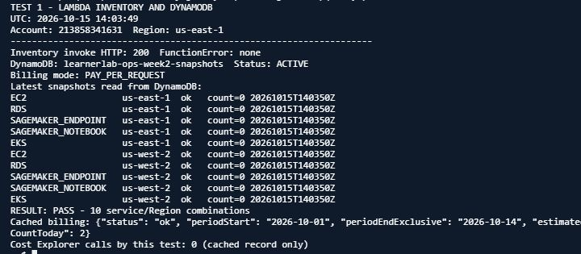
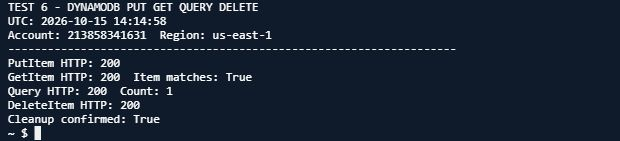
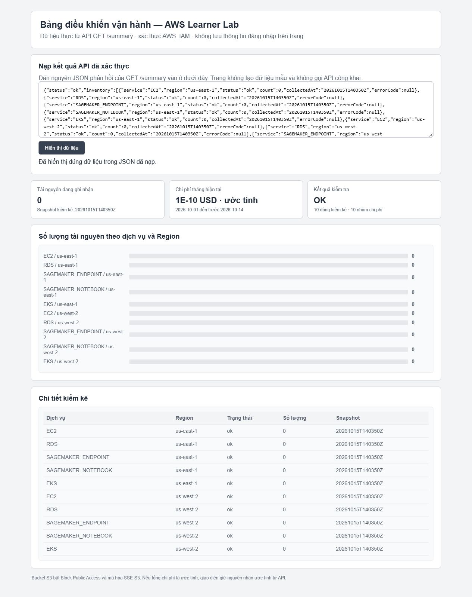
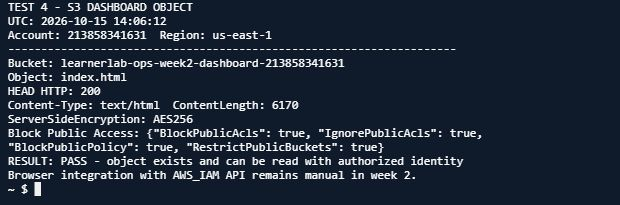

# Tuần 2 — Triển khai chức năng lõi và kiểm thử

Theo báo cáo ngày 15/10/2026, các chức năng lõi đã được triển khai và kiểm thử trên AWS Learner Lab. Tài nguyên chính ở `us-east-1`, dùng `LabRole` có sẵn. Báo cáo Word được nộp riêng qua hệ thống môn học; repo có worklog và ảnh kiểm thử chọn lọc.

## Thành phần đã triển khai

- **Lambda:** `inventory-core`, `billing-collector`, `read-api`, `threshold-alert`. Worklog cũng ghi một Lambda `ec2-collector` là phép thử sớm ngày 11/10; luồng kiểm kê hiện tại dùng `inventory-core`.
- **DynamoDB:** `learnerlab-ops-week2-snapshots`, `PAY_PER_REQUEST`, lưu snapshot tài nguyên và chi phí.
- **API Gateway:** HTTP API `qvpnt8h5yh`, route `GET /summary`, stage `$default`, xác thực `AWS_IAM`.
- **S3:** `learnerlab-ops-week2-dashboard-213858341631`; `index.html` riêng tư, mã hóa SSE-S3 và đủ bốn cờ Block Public Access.
- **EventBridge:** lịch kiểm kê mỗi 6 giờ; billing lúc 02:00 UTC; kiểm tra ngưỡng lúc 02:10 UTC. Ba rule được ghi nhận `ENABLED`.
- **SNS:** topic cảnh báo có email subscription đã xác nhận. Người nhận xác nhận đã nhận thư thử ngày 13/10; địa chỉ email không được đưa vào repo công khai.
- **Cost Explorer:** snapshot billing có cờ `estimated=true`; diễn giải đầy đủ ở [bảng nguồn dữ liệu](../docs/data-sources.md).

## Mã nguồn đã triển khai

Repo có [mã handler của cả bốn Lambda và giao diện dashboard](src/README.md), được lấy từ bản đang chạy trên AWS ngày 15/10/2026. Tên hàm, handler, mục đích và biến môi trường (chỉ tên, không có giá trị nhạy cảm) được đối chiếu ở đó. [Mã kiểm kê](src/lambdas/inventory-core/index.py) lưu snapshot EC2/RDS/SageMaker/EKS; [mã billing](src/lambdas/billing-collector/index.py) truy vấn Cost Explorer; [mã đọc API](src/lambdas/read-api/index.py) trả snapshot mới nhất; [mã cảnh báo](src/lambdas/threshold-alert/lambda_function.py) gửi SNS khi đạt ngưỡng; [giao diện tĩnh](src/dashboard/index.html) nhận JSON `GET /summary` đã xác thực do người dùng dán vào.

## Kiểm thử thu thập và lưu trữ

Lambda kiểm kê trả HTTP 200, không có `FunctionError`. Snapshot DynamoDB có đủ 10 tổ hợp (5 nhóm dịch vụ × 2 Region), mỗi dòng `status=ok`, `count=0`. Đây là trạng thái tại thời điểm chụp và trong phạm vi tài nguyên đã hỗ trợ.

Các thao tác `PutItem`, `GetItem`, `Query`, `DeleteItem` trả HTTP 200; bản ghi tạm được xóa sau khi kiểm tra.

## Kiểm thử API và giao diện

Yêu cầu `GET /summary` có chữ ký SigV4 trả HTTP 200; yêu cầu không ký trả HTTP 403. Giao diện S3 hiển thị JSON thật đã nạp thủ công; trang chưa tự gọi API do route giữ `AWS_IAM`.

## Kiểm thử S3 và đối chiếu chi phí

`index.html` tồn tại, `HEAD` trả HTTP 200 với danh tính được phép. Bucket giữ riêng tư, mã hóa AES256 và bật đủ bốn lựa chọn Block Public Access.

Snapshot ghi `1E-10 USD` (`0.0000000001 USD`), `estimated=true`, cho kỳ `2026-10-01` đến trước `2026-10-14`. `requestCountToday=2` thuộc snapshot ngày 13/10; lần kiểm tra ngày 15/10 chỉ đọc DynamoDB.

## Worklog, dữ liệu và giới hạn

- [Worklog theo ngày](worklog.csv) ghi 2 giờ ngày 10/10, 3 giờ ngày 11/10, 3 giờ ngày 12/10 và 3 giờ ngày 13/10 theo xác nhận của sinh viên. Hai mốc 11/10 và 13/10 được xác nhận bổ sung ngày 16/10; không có giờ bắt đầu/kết thúc hoặc phân bổ theo tác vụ, và không được xác minh bằng CloudTrail.
- [Phân công và thời lượng tuần 2](docs/10-week2-assignment-and-time.md) trình bày riêng phần việc của sinh viên, phần LLM/AI (ChatGPT) hỗ trợ/trực tiếp thực hiện và tổng 11 giờ do sinh viên tự xác nhận.
- [Kế hoạch tuần 3](docs/09-week3-plan.md) tách riêng các bước tích hợp, bảo mật, giám sát CloudWatch và tự động hóa/IaC dự kiến.
- [Nguồn dữ liệu và cách diễn giải](../docs/data-sources.md) phân biệt API AWS gốc với DynamoDB là nơi lưu snapshot.
- Ảnh công khai không gồm ảnh có địa chỉ email nhận SNS.
- LLM/AI (ChatGPT) hỗ trợ viết mã, triển khai và chạy các kiểm thử AWS, theo khai báo trong báo cáo/worklog.
