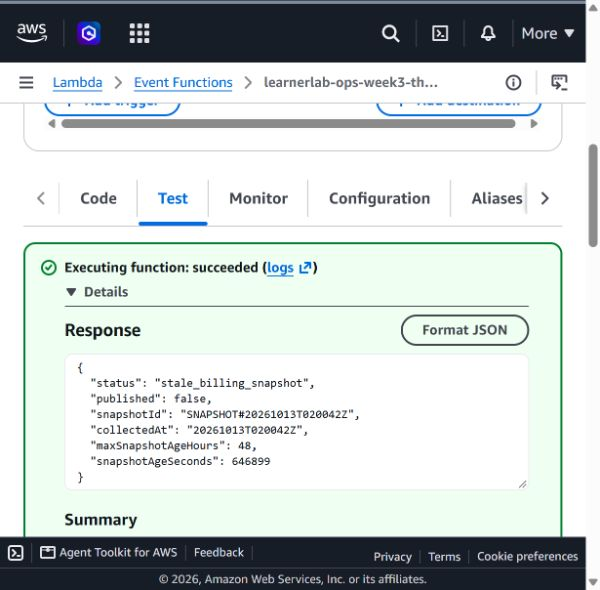

# Triển khai freshness guard trên Lambda thử — 20/10/2026

Tài khoản Learner Lab `213858341631`, Region `us-east-1`. Mục tiêu là hàm thử riêng `learnerlab-ops-week3-threshold-negative-test` (Python 3.13, handler `lambda_function.lambda_handler`). Mã nguồn: [`tuan_3/src/threshold-alert/lambda_function.py`](../src/threshold-alert/lambda_function.py). ZIP chỉ chứa tệp `lambda_function.py` ở thư mục gốc, tạo từ mã nguồn này rồi tải qua **Code source → Update → Update from a .zip file** trên Lambda Console. Console thông báo `Successfully updated the function`.

SHA-256 của tệp nguồn là `73b193197e9e6d199b38d92c8fa8c2939cad3b3ec32b8a5b20f2ba11006f9041` (hex). SHA-256 của ZIP ở dạng Base64 là `poj2oLk5YCZRIlT653wU1ay+LusuGwaXN1xrOIiuOJk=`; trường **Code SHA-256** của Lambda Console và kết quả gọi hàm đều trả cùng giá trị. Như vậy gói kiểm thử trên AWS khớp với ZIP đã chuẩn bị từ mã nguồn.

Các hash trong đoạn này thuộc gói triển khai **ngày 20/10**. Commit `093141b` ngày 21/10 chỉ sửa mô tả đầu tệp nguồn để dùng cho Lambda sản phẩm, nên hash tệp hiện tại khác; logic handler không đổi.

Gọi đồng bộ `$LATEST` bằng JSON `{}` sau khi cập nhật. Console báo `Executing function: succeeded`, Request ID `e36c2608-b168-48b7-abbb-794d81a5dac4`. Phản hồi:

```json
{
  "status": "stale_billing_snapshot",
  "published": false,
  "snapshotId": "SNAPSHOT#20261013T020042Z",
  "collectedAt": "20261013T020042Z",
  "maxSnapshotAgeHours": 48,
  "snapshotAgeSeconds": 646899
}
```

Snapshot đang lưu đã quá giới hạn 48 giờ nên Lambda kết thúc trước bước kiểm tra subscription và `sns:Publish`. Phản hồi này xác minh nhánh chặn snapshot cũ trên AWS; nó không xác nhận chi phí hiện tại ngày 20/10. **Tại thời điểm phép thử 20/10**, chỉ Lambda thử được cập nhật. Ngày 21/10, cùng handler được đưa lên [Lambda cảnh báo sản phẩm](10-product-alert-deployment.md).


