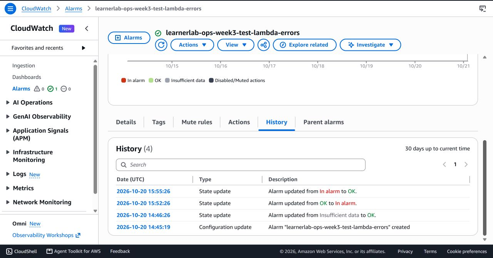

# Kiểm thử API SigV4 và CloudWatch alarm — 20/10/2026

**Account:** `213858341631`
**Region:** `us-east-1`
**API:** `learnerlab-ops-week2-api` (`qvpnt8h5yh`), stage `$default`
**Lambda thử:** `learnerlab-ops-week3-threshold-negative-test`

## API Gateway `GET /summary`

AWS Console hiển thị route `GET /summary` dùng `IAM (built-in)` và integration ID `gr1j2oa`. Stage `$default` bật automatic deployment với invoke URL:

```text
https://qvpnt8h5yh.execute-api.us-east-1.amazonaws.com
```

Hai phép thử chỉ đọc:

| Request | Kết quả |
|---|---|
| Mở `/summary` không có SigV4 trong trình duyệt | Body trả `{"message":"Forbidden"}`. |
| Gửi GET có SigV4 từ CloudShell bằng credentials sẵn có của phiên Lab | `HTTP 200`; body là JSON object có các khóa cấp cao `billing`, `inventory`, `status`. |

Đối chiếu tiếp phản hồi API với các bản ghi snapshot mới nhất trong DynamoDB (chỉ đọc, cùng account/region):

| Kiểm tra | Kết quả |
|---|---|
| HTTP response | `200` |
| Các trường trạng thái, số lượng và thời điểm thu thập của inventory EC2 `us-east-1` khớp snapshot DynamoDB | `True` |
| Các trường trạng thái, kỳ dữ liệu, currency, tổng hợp và số request của billing khớp snapshot DynamoDB | `True` |
| Trạng thái tổng thể API | `ok` |

Lệnh chỉ in các cờ khớp/không khớp và trạng thái tổng thể; không in hoặc lưu giá trị chi phí hay danh sách tài nguyên. Kết quả xác nhận đường đọc DynamoDB → API trả đúng snapshot đang lưu tại thời điểm kiểm tra.

Phép thử chỉ ghi mã HTTP và tên khóa JSON; không lưu giá trị billing hoặc chi tiết tài nguyên vào repo. Không đưa access key/session token vào lệnh, frontend, evidence hoặc Git. Kết quả xác nhận API đọc hoạt động với chữ ký và từ chối request không xác thực. Dashboard S3 không được thay đổi; vẫn nạp JSON thủ công theo quyết định giữ AWS_IAM.

## CloudWatch alarm — thử cả hai nhánh

Alarm `learnerlab-ops-week3-test-lambda-errors` theo dõi `AWS/Lambda / Errors` của đúng Lambda thử, statistic `Sum`, period 1 phút, điều kiện `> 0`, một datapoint trên một datapoint. Alarm không có SNS/Lambda action.

1. Trước fault-injection, alarm ở `OK` sau datapoint `Errors=0` lúc `2026-10-20 14:46:26 UTC`.
2. Gửi payload sai kiểu `[1]` đúng một lần tới **Lambda thử tuần 3**. Handler cần object và gọi `event.get`; payload này trả `StatusCode=200`, `FunctionError=Unhandled`. Lỗi thật của invocation được CloudWatch ghi nhận, không sửa dữ liệu DynamoDB, không gọi SNS `Publish`.
3. Alarm History xác nhận `OK → In alarm` lúc `2026-10-20 15:52:26 UTC`.
4. Kiểm tra subscription topic trước khi phục hồi: chỉ có một email subscription với `SubscriptionArn=PendingConfirmation`; địa chỉ email không được truy vấn/in ra. Gọi nhánh `{"test":true}` trả `StatusCode=200`, `FunctionError=null`, `status=sns_subscription_pending_confirmation`, `published=false`, `pendingSubscriptionCount=1`.
5. CloudWatch xác nhận `In alarm → OK` lúc `2026-10-20 15:55:26 UTC`. Không có email cảnh báo nào được gửi.

Đây là fault-injection có kiểm soát để kiểm tra alarm, được thực hiện riêng trên hàm thử; không phải dữ liệu vận hành hoặc báo cáo lỗi sản phẩm. Tại thời điểm phép thử 20/10, Lambda và topic tuần 2 không bị thay đổi. Sau phép thử, alarm ở `OK` và SNS subscription thử vẫn chờ xác nhận. Ngày 21/10, mã tuần 3 được [cập nhật riêng lên Lambda sản phẩm](10-product-alert-deployment.md).



## Giới hạn còn ghi nhận

CloudShell vẫn explicit-deny một số truy vấn đọc CloudWatch/Lambda/EventBridge qua policy `voc-cancel-cred`. Cấu hình alarm và trạng thái đã được xác nhận qua CloudWatch Console; không tìm cách gỡ hoặc vòng qua policy. Bằng chứng về giới hạn quyền: [06-current-lab-permission-block.md](06-current-lab-permission-block.md).
