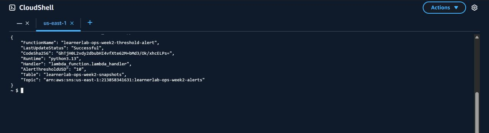
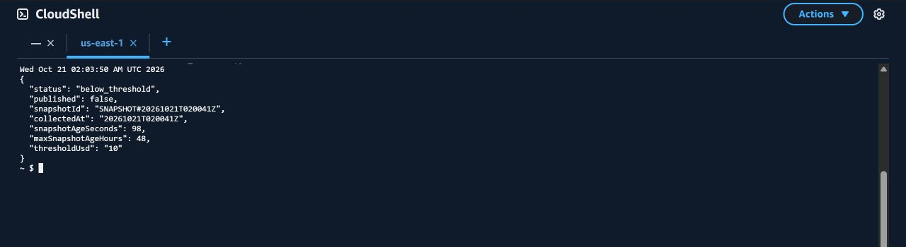

# Lambda cảnh báo sản phẩm chạy mã tuần 3 — 21/10/2026

**Môi trường:** AWS Learner Lab, account `213858341631`, Region `us-east-1`.  
**Hàm sản phẩm:** `learnerlab-ops-week2-threshold-alert`, runtime Python 3.13, handler `lambda_function.lambda_handler`.  
**Mã nguồn:** [`tuan_3/src/threshold-alert/lambda_function.py`](../src/threshold-alert/lambda_function.py), commit [`093141b`](https://github.com/leminhhuy-ute/learnerlab-ops-dashboard/commit/093141b).

## Triển khai và đối chiếu

Trước khi cập nhật, tải gói mã đang chạy của Lambda sản phẩm để lưu bản sao cục bộ. Tệp `lambda_function.py` trong gói cũ có SHA-256 `f49527e06555490fec728acf1d92d66dd5df54f5b8e105abd1de4b04ce2000c3`, khớp mã tuần 2 trong repo. Bản sao ZIP chỉ lưu cục bộ, không đưa lên Git.

Kiểm thử cục bộ mã tuần 3 đạt **12/12**. CloudShell lấy tệp nguồn từ commit trên, đối chiếu SHA-256 nguồn `11e5e5867142fedc324460c699a6df75f7fefd34e25ff7cd34f13dad6000538e` với máy cục bộ, rồi đóng gói ZIP chỉ chứa `lambda_function.py` ở thư mục gốc. Lệnh `aws lambda update-function-code` cập nhật đúng hàm sản phẩm. AWS trả `LastUpdateStatus=Successful`; `CodeSha256` của hàm khớp SHA-256 Base64 của ZIP trên CloudShell: `GhTjH0L2vdy2dbubHI4vfXte62M+bMd3/Ok/xhcELPs=`.

Cấu hình sau cập nhật: `ALERT_THRESHOLD_USD=10`, bảng `learnerlab-ops-week2-snapshots`, topic SNS `learnerlab-ops-week2-alerts`, `ACCOUNT_ID=213858341631`. Không chỉnh các biến môi trường, trigger EventBridge, quyền IAM hay SNS subscription. Giới hạn tuổi snapshot dùng mặc định **48 giờ** từ mã mới vì chưa đặt `MAX_SNAPSHOT_AGE_HOURS`.



## Kiểm thử Lambda sản phẩm

Gọi đồng bộ hàm sản phẩm với payload bình thường `{}` qua `aws lambda invoke`; AWS trả `StatusCode=200`, `FunctionError=null`. Phản hồi đã quan sát:

```json
{
  "status": "below_threshold",
  "published": false,
  "snapshotId": "SNAPSHOT#20261021T020041Z",
  "collectedAt": "20261021T020041Z",
  "snapshotAgeSeconds": 98,
  "maxSnapshotAgeHours": 48,
  "thresholdUsd": "10"
}
```

Snapshot này được thu thập lúc `2026-10-21 02:00:41 UTC`; khi gọi thử, nó còn mới và dưới ngưỡng sản phẩm. Hàm không phát thông báo SNS. Ảnh dưới chỉ hiển thị các trường cần để kiểm tra nhánh và ẩn giá trị chi phí tài khoản; dữ liệu phản hồi gốc vẫn nằm trong CloudShell của phiên Lab.



Không cố ý sửa snapshot billing thật thành dữ liệu cũ hoặc vượt ngưỡng để thử trên hàm sản phẩm. Nhánh snapshot cũ đã chạy trên Lambda thử với bản ghi lịch sử thật ngày 13/10, xem [phép thử freshness](05-live-freshness-guard.md). Nhánh SNS chưa xác nhận được thử trên topic và Lambda thử riêng, xem [kiểm thử bổ sung](11-additional-live-results.md). Trường hợp subscriber đã xác nhận và chi phí vượt ngưỡng được kiểm thử cục bộ bằng test double, chưa kích hoạt một email thử mới từ Lambda sản phẩm trong lần cập nhật này.
