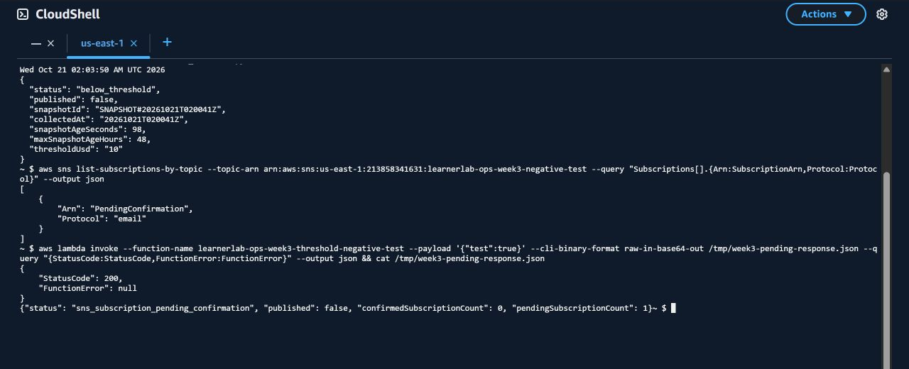

# Ảnh kết quả bổ sung — 21/10/2026

**Account:** `213858341631`

**Region:** `us-east-1`

## SNS chưa xác nhận trên tài nguyên thử

Topic `learnerlab-ops-week3-negative-test` vẫn có đúng một email subscription ở trạng thái `PendingConfirmation`; lệnh kiểm tra chỉ truy vấn ARN và protocol, không in địa chỉ email. Gọi Lambda thử `learnerlab-ops-week3-threshold-negative-test` với `{"test":true}` trả `StatusCode=200`, `FunctionError=null`, `status=sns_subscription_pending_confirmation`, `published=false`, `confirmedSubscriptionCount=0`, `pendingSubscriptionCount=1`. Hàm không gọi SNS Publish. Đây là phép thử tiêu cực theo góp ý của GVHD; không phải phép thử trên topic cảnh báo sản phẩm.

## CloudWatch alarm của Lambda thử

CloudWatch History xác nhận alarm `learnerlab-ops-week3-test-lambda-errors` đã nhận metric lỗi của Lambda thử và chuyển `OK → In alarm` lúc `2026-10-20 15:52:26 UTC`, sau đó `In alarm → OK` lúc `15:55:26 UTC`. Ảnh được chụp khi kiểm tra lại ngày 21/10; alarm đang `OK`. Alarm không gắn action gửi thông báo. Bối cảnh và payload lỗi có kiểm soát nằm trong [biên bản kiểm thử API/alarm](09-api-and-alarm-live-tests.md).

Ảnh chụp từ AWS Console/CloudShell thật. Chỉ cắt thanh tài khoản ở đầu ảnh để không công khai địa chỉ email; không sửa số liệu, trạng thái hoặc đầu ra kiểm thử.
