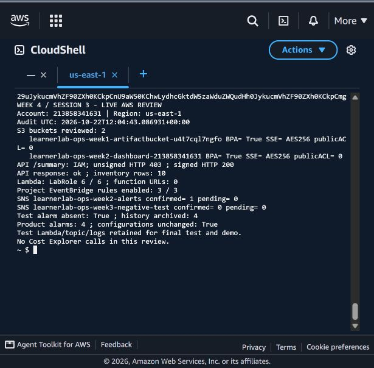

# Rà soát bảo mật và dọn alarm thử — buổi 3, 22/10/2026

**Account:** `213858341631` · **Region chính:** `us-east-1`.

Kiểm tra đầu lúc 18:57 ICT; bản rà soát sau dọn được lấy lúc **2026-10-22T12:04:43.086931+00:00 UTC** (19:04:43 ICT ngày 22/10). Mã [`review_security.py`](../scripts/review_security.py) chạy trong AWS CloudShell bằng phiên Learner Lab. SHA-256 tệp nguồn trên CloudShell khớp repo: `6b936068e797da9b8ba87c5944896d2338917a6997d8323d11b64ab2424c3ee4`. Script chỉ đọc cấu hình; thao tác dọn alarm được chạy riêng sau bước sao lưu và kiểm tra phụ thuộc.

## Kết quả bảo mật

| Hạng mục đã kiểm tra | Kết quả quan sát |
|---|---|
| Hai bucket dự án | Bucket artifact tuần 1 và dashboard tuần 2 đều ở `us-east-1`; bốn cờ Block Public Access đều `true`, mã hóa `AES256`/SSE-S3, không có ACL cấp cho AllUsers/AuthenticatedUsers. Cả hai không có bucket policy; không diễn giải điều đó thành đã có chính sách bắt buộc HTTPS. |
| Tag S3 | Cả hai bucket có `Project=learnerlab-ops`, `Owner=24110019`, `Environment=learner-lab`. |
| API Gateway | Chỉ thấy route `GET /summary`, `AuthorizationType=AWS_IAM`; stage `$default` có `AutoDeploy=true`. |
| Kiểm tra HTTP sau dọn | Request không ký trả **403**. Request SigV4 trả **200**, `status=ok`, **10** hàng inventory, billing `status=ok`; không xuất tổng chi phí hoặc credentials. Phản hồi có xác thực được ghi lúc `2026-10-22T12:03:42Z` (19:03:42 ICT). |
| Lambda | **6/6** hàm có prefix dự án tại `us-east-1` dùng `LabRole`; API liệt kê Function URL trả **0** trên cả sáu hàm. `us-west-2` không có Lambda mang prefix dự án. |
| Resource policy của Lambda | Ba hàm theo lịch cho phép `events.amazonaws.com` với `AWS:SourceArn` giới hạn đúng rule dự án; hàm đọc API cho phép `apigateway.amazonaws.com` với SourceArn giới hạn API hiện có và `GET /summary`. Hai hàm còn lại không có resource policy trong kết quả đọc. Đây không phải đánh giá toàn bộ quyền hiệu lực của `LabRole`. |
| SNS | Topic sản phẩm có **1** subscriber đã xác nhận, **0** đang chờ. Topic thử hiện **0** subscriber đã xác nhận và **0** đang chờ; khác với bản ghi thử tuần 3 khi còn `PendingConfirmation`. Không suy đoán nguyên nhân subscription cũ biến mất. Policy của hai topic có điều kiện `AWS:SourceOwner` bằng account Lab; không chỉnh policy/subscription trong buổi này. |
| EventBridge | Ba rule dự án đều `ENABLED` và trỏ đúng Lambda sản phẩm: alert, billing, inventory. Không có rule dự án trỏ tới Lambda thử trong kết quả đọc; hàm thử không có event source mapping. |

## Dọn tài nguyên có kiểm soát

Chỉ dọn **một alarm thử** `learnerlab-ops-week3-test-lambda-errors`. Trước thao tác, đã xác nhận dimension là `FunctionName=learnerlab-ops-week3-threshold-negative-test`, metric `AWS/Lambda Errors`, ba nhóm action đều rỗng và không có composite alarm tham chiếu. Cấu hình, tags và cả **4** bản ghi lịch sử đã lưu trước; tệp tải về máy có SHA-256 khớp CloudShell. [Bản lưu cấu hình và lịch sử](04-test-alarm-archive-2026-10-22.md) có dữ liệu tạo lại alarm nếu cần.

Lệnh dọn chỉ chỉ định đúng tên alarm thử:

```bash
aws cloudwatch delete-alarms --region us-east-1   --alarm-names learnerlab-ops-week3-test-lambda-errors
```

Lần gọi API tương đương trong CloudShell trả **HTTP 200** lúc `2026-10-22T12:01:54Z` (19:01:54 ICT). Kiểm tra lúc `12:02:38Z` xác nhận:

- Alarm thử không còn trong `describe_alarms`.
- Bốn alarm sản phẩm vẫn còn; các tham số cấu hình đối chiếu với bản trước dọn đều **khớp**. Cả bốn ở `OK` tại lúc kiểm tra. Không lấy trạng thái `OK` làm bằng chứng target/lịch đã chạy thành công.
- Request API SigV4 sau dọn vẫn trả 200; request không ký bị từ chối 403.

| Tài nguyên | Xử lý trong buổi 3 | Lý do |
|---|---|---|
| Alarm Lambda thử tuần 3 | Đã lưu rồi dọn | Phép thử chuyển trạng thái đã có lịch sử/ảnh; alarm chỉ giám sát hàm thử và không có action. |
| Lambda và topic thử tuần 3 | Giữ lại | Cần cho buổi cuối nếu thực hiện nhánh vượt ngưỡng trên topic thử có subscriber đã xác nhận và cho demo. Chưa tạo subscription mới hoặc gửi email trong buổi này. |
| Log group Lambda thử | Giữ retention **7 ngày** như cấu hình đang có; không sửa/xóa | Giữ log kiểm thử để đối chiếu; đã có ảnh và biên bản tuần 3 trong repo. `storedBytes=4396` lúc đọc. |
| Bốn alarm sản phẩm, ba rule, hai bucket, bảng snapshot, VPC và Lambda sản phẩm | Giữ nguyên | Đang phục vụ luồng dữ liệu và bản demo. |
| Lambda `learnerlab-ops-week2-ec2-collector` | Giữ lại | Chưa kiểm tra toàn bộ khả năng gọi thủ công/phụ thuộc ngoài các rule dự án; không coi việc thiếu resource policy là đủ để kết luận có thể xóa. |

## Ảnh kết quả thật

Ảnh CloudShell hiển thị bản tóm tắt được tạo từ các phản hồi AWS vừa lưu; không dựng lại giao diện hoặc thêm kết quả giả. Phần summary không chứa email, credentials, URL ký tạm thời hay tổng billing.



## Phạm vi còn lại và thời lượng

Hoàn tất nhóm công việc thứ ba tương ứng **75% kế hoạch bốn buổi**, không phải phép đo theo số giờ. Buổi cuối còn chốt bản sửa `Items=[]` trên Lambda đọc API, tổng kết và demo; nhánh gửi cảnh báo thật trên topic thử có subscriber đã xác nhận chưa thực hiện. Nếu tiếp tục phép thử đó cần đăng ký/xác nhận lại trên topic thử vì hiện không có subscriber. Không sửa snapshot billing thật hay hạ ngưỡng 10 USD/topic của Lambda sản phẩm.

Sinh viên xác nhận **thêm 2 giờ** cho buổi 3 ngày 22/10/2026. Đây là một buổi riêng ngoài 3 giờ đã ghi trước đó cùng ngày; worklog tuần 4 hiện cộng **7 giờ** (21/10: 2 giờ; 22/10: 3 + 2 giờ). Thời lượng do sinh viên xác nhận; các mốc AWS không xác minh thời gian tự học. LLM/AI ChatGPT thực hiện script CloudShell, lưu/xóa alarm thử, chạy kiểm tra HTTP, thu ảnh và biên soạn minh chứng; phần hỗ trợ này được khai riêng, không cộng vào giờ sinh viên.

## Dữ liệu cấu hình đã lọc để đối chiếu

Tệp nguồn chỉ xuất các trường phục vụ kiểm tra. Dữ liệu dưới đây được tải trực tiếp từ CloudShell, gồm kết quả rà soát sau dọn, so sánh alarm và phản hồi API đã bỏ giá trị tiền. Các thao tác đọc không gọi Cost Explorer.

<details>
<summary>Xem kết quả AWS đã lưu</summary>

```json
{
  "audit": {
    "checkedAtUtc": "2026-10-22T12:04:43.086931+00:00",
    "account": "213858341631",
    "buckets": [
      {
        "name": "learnerlab-ops-week1-artifactbucket-u4t7cql7ngfo",
        "region": "us-east-1",
        "publicAccessBlock": {
          "BlockPublicAcls": true,
          "IgnorePublicAcls": true,
          "BlockPublicPolicy": true,
          "RestrictPublicBuckets": true
        },
        "encryption": [
          "AES256"
        ],
        "isPublicPolicy": false,
        "hasBucketPolicy": false,
        "publicAclGrantCount": 0,
        "tags": {
          "Project": "learnerlab-ops",
          "Owner": "24110019",
          "Environment": "learner-lab"
        }
      },
      {
        "name": "learnerlab-ops-week2-dashboard-213858341631",
        "region": "us-east-1",
        "publicAccessBlock": {
          "BlockPublicAcls": true,
          "IgnorePublicAcls": true,
          "BlockPublicPolicy": true,
          "RestrictPublicBuckets": true
        },
        "encryption": [
          "AES256"
        ],
        "isPublicPolicy": false,
        "hasBucketPolicy": false,
        "publicAclGrantCount": 0,
        "tags": {
          "Project": "learnerlab-ops",
          "Environment": "learner-lab",
          "Owner": "24110019"
        }
      }
    ],
    "apiRoutes": [
      {
        "RouteKey": "GET /summary",
        "AuthorizationType": "AWS_IAM",
        "Target": "integrations/gr1j2oa"
      }
    ],
    "apiStages": [
      {
        "StageName": "$default",
        "AutoDeploy": true
      }
    ],
    "functions": [
      {
        "name": "learnerlab-ops-week2-billing-collector",
        "role": "LabRole",
        "functionUrlCount": 0,
        "functionUrlAuthTypes": [],
        "invokePolicy": [
          {
            "Effect": "Allow",
            "Principal": {
              "Service": "events.amazonaws.com"
            },
            "Action": "lambda:InvokeFunction",
            "Condition": {
              "ArnLike": {
                "AWS:SourceArn": "arn:aws:events:us-east-1:213858341631:rule/learnerlab-ops-week2-billing-daily"
              }
            }
          }
        ]
      },
      {
        "name": "learnerlab-ops-week2-read-api",
        "role": "LabRole",
        "functionUrlCount": 0,
        "functionUrlAuthTypes": [],
        "invokePolicy": [
          {
            "Effect": "Allow",
            "Principal": {
              "Service": "apigateway.amazonaws.com"
            },
            "Action": "lambda:InvokeFunction",
            "Condition": {
              "ArnLike": {
                "AWS:SourceArn": "arn:aws:execute-api:us-east-1:213858341631:qvpnt8h5yh/*/GET/summary"
              }
            }
          }
        ]
      },
      {
        "name": "learnerlab-ops-week2-ec2-collector",
        "role": "LabRole",
        "functionUrlCount": 0,
        "functionUrlAuthTypes": [],
        "invokePolicy": []
      },
      {
        "name": "learnerlab-ops-week2-inventory-core",
        "role": "LabRole",
        "functionUrlCount": 0,
        "functionUrlAuthTypes": [],
        "invokePolicy": [
          {
            "Effect": "Allow",
            "Principal": {
              "Service": "events.amazonaws.com"
            },
            "Action": "lambda:InvokeFunction",
            "Condition": {
              "ArnLike": {
                "AWS:SourceArn": "arn:aws:events:us-east-1:213858341631:rule/learnerlab-ops-week2-inventory-6h"
              }
            }
          }
        ]
      },
      {
        "name": "learnerlab-ops-week3-threshold-negative-test",
        "role": "LabRole",
        "functionUrlCount": 0,
        "functionUrlAuthTypes": [],
        "invokePolicy": []
      },
      {
        "name": "learnerlab-ops-week2-threshold-alert",
        "role": "LabRole",
        "functionUrlCount": 0,
        "functionUrlAuthTypes": [],
        "invokePolicy": [
          {
            "Effect": "Allow",
            "Principal": {
              "Service": "events.amazonaws.com"
            },
            "Action": "lambda:InvokeFunction",
            "Condition": {
              "ArnLike": {
                "AWS:SourceArn": "arn:aws:events:us-east-1:213858341631:rule/learnerlab-ops-week2-alert-daily"
              }
            }
          }
        ]
      }
    ],
    "rules": [
      {
        "name": "learnerlab-ops-week2-alert-daily",
        "state": "ENABLED",
        "targetArns": [
          "arn:aws:lambda:us-east-1:213858341631:function:learnerlab-ops-week2-threshold-alert"
        ]
      },
      {
        "name": "learnerlab-ops-week2-billing-daily",
        "state": "ENABLED",
        "targetArns": [
          "arn:aws:lambda:us-east-1:213858341631:function:learnerlab-ops-week2-billing-collector"
        ]
      },
      {
        "name": "learnerlab-ops-week2-inventory-6h",
        "state": "ENABLED",
        "targetArns": [
          "arn:aws:lambda:us-east-1:213858341631:function:learnerlab-ops-week2-inventory-core"
        ]
      }
    ],
    "testEventSourceMappings": [],
    "topics": [
      {
        "name": "learnerlab-ops-week2-alerts",
        "confirmed": 1,
        "pending": 0,
        "policy": [
          {
            "Effect": "Allow",
            "Principal": {
              "AWS": "*"
            },
            "Action": [
              "SNS:GetTopicAttributes",
              "SNS:SetTopicAttributes",
              "SNS:AddPermission",
              "SNS:RemovePermission",
              "SNS:DeleteTopic",
              "SNS:Subscribe",
              "SNS:ListSubscriptionsByTopic",
              "SNS:Publish"
            ],
            "Condition": {
              "StringEquals": {
                "AWS:SourceOwner": "213858341631"
              }
            }
          }
        ]
      },
      {
        "name": "learnerlab-ops-week3-negative-test",
        "confirmed": 0,
        "pending": 0,
        "policy": [
          {
            "Effect": "Allow",
            "Principal": {
              "AWS": "*"
            },
            "Action": [
              "SNS:GetTopicAttributes",
              "SNS:SetTopicAttributes",
              "SNS:AddPermission",
              "SNS:RemovePermission",
              "SNS:DeleteTopic",
              "SNS:Subscribe",
              "SNS:ListSubscriptionsByTopic",
              "SNS:Publish"
            ],
            "Condition": {
              "StringEquals": {
                "AWS:SourceOwner": "213858341631"
              }
            }
          }
        ]
      }
    ],
    "alarms": [
      {
        "AlarmName": "learnerlab-ops-week3-alert-rule-failures",
        "StateValue": "OK",
        "AlarmActions": [],
        "OKActions": [],
        "InsufficientDataActions": [],
        "Dimensions": [
          {
            "Name": "RuleName",
            "Value": "learnerlab-ops-week2-alert-daily"
          }
        ]
      },
      {
        "AlarmName": "learnerlab-ops-week3-billing-rule-failures",
        "StateValue": "OK",
        "AlarmActions": [],
        "OKActions": [],
        "InsufficientDataActions": [],
        "Dimensions": [
          {
            "Name": "RuleName",
            "Value": "learnerlab-ops-week2-billing-daily"
          }
        ]
      },
      {
        "AlarmName": "learnerlab-ops-week3-inventory-rule-failures",
        "StateValue": "OK",
        "AlarmActions": [],
        "OKActions": [],
        "InsufficientDataActions": [],
        "Dimensions": [
          {
            "Name": "RuleName",
            "Value": "learnerlab-ops-week2-inventory-6h"
          }
        ]
      },
      {
        "AlarmName": "learnerlab-ops-week3-product-alert-errors",
        "StateValue": "OK",
        "AlarmActions": [],
        "OKActions": [],
        "InsufficientDataActions": [],
        "Dimensions": [
          {
            "Name": "FunctionName",
            "Value": "learnerlab-ops-week2-threshold-alert"
          }
        ]
      }
    ],
    "testLogGroups": [
      {
        "logGroupName": "/aws/lambda/learnerlab-ops-week3-threshold-negative-test",
        "retentionInDays": 7,
        "storedBytes": 4396
      }
    ],
    "west2ProjectFunctionCount": 0
  },
  "cleanup": {
    "checkedAtUtc": "2026-10-22T12:02:38.253337+00:00",
    "testAlarmAbsent": true,
    "productAlarmCount": 4,
    "productAlarmConfigurationsUnchanged": true,
    "states": {
      "learnerlab-ops-week3-alert-rule-failures": "OK",
      "learnerlab-ops-week3-billing-rule-failures": "OK",
      "learnerlab-ops-week3-inventory-rule-failures": "OK",
      "learnerlab-ops-week3-product-alert-errors": "OK"
    }
  },
  "api": {
    "checkedAtUtc": "2026-10-22T12:03:42.376332+00:00",
    "signedHttp": 200,
    "status": "ok",
    "inventoryRows": 10,
    "billingStatus": "ok"
  },
  "unsignedHttp": 403,
  "sourceSha256": "6b936068e797da9b8ba87c5944896d2338917a6997d8323d11b64ab2424c3ee4"
}
```

</details>
