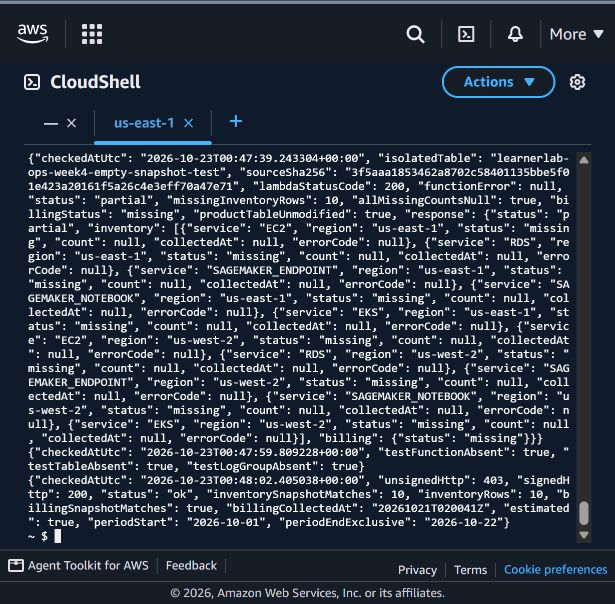

# Triển khai read-api và hồi quy luồng dữ liệu — 23/10/2026

**Môi trường:** AWS Learner Lab, account `213858341631`, `us-east-1`. Thời gian dưới đây dùng ICT (UTC+7); bản ghi lệnh giữ UTC để đối chiếu.

## Bản sửa đã có trên Lambda sản phẩm

Ngày 21/10, kiểm thử phát hiện `latest()` gây `IndexError` khi truy vấn DynamoDB trả `Items=[]`. Bản sửa trả `None` để handler ghi trạng thái `missing`, giữ `count=null`. Lúc **07:47:13 ngày 23/10**, đã sao lưu ZIP cũ, cập nhật `learnerlab-ops-week2-read-api` với RevisionId và xác minh `LastUpdateStatus=Successful`. Nội dung `index.py` trong ZIP tải lại từ AWS khớp từng byte với [mã nguồn trong repo](../../tuan_2/src/lambdas/read-api/index.py). Handler, runtime, LabRole, bộ nhớ, timeout và biến môi trường được giữ nguyên.

SHA-256 nguồn read-api: `3f5aaa1853462a8702c58401135bbe5f01e423a20161f5a26c4e3eff70a47e71`.

## Các phép thử thực tế

| Kiểm thử | Cách thực hiện | Kết quả quan sát |
|---|---|---|
| Lambda sản phẩm sau cập nhật | Invoke handler trên bảng snapshot hiện có | `StatusCode=200`, không FunctionError, `status=ok`, 10 dòng inventory và billing `ok`. |
| Bảng DynamoDB rỗng | Tạo bảng và Lambda dùng một lần tên `learnerlab-ops-week4-empty-snapshot-test`, cùng mã read-api, dùng LabRole và tag Project/Owner/Purpose | 07:47:39: `StatusCode=200`, không FunctionError; `status=partial`, 10 dòng `missing`, toàn bộ count là `null`, billing `missing`. Không sửa/xóa snapshot sản phẩm. |
| Dọn phép thử rỗng | Xóa đúng Lambda, bảng và log group dùng một lần vừa tạo | 07:47:59: xác nhận cả ba không còn tồn tại. |
| Thu inventory mới | Gọi Lambda inventory-core | Snapshot `20261023T005031Z`: cả 10 tổ hợp dịch vụ/Region trả `ok`, `count=0`. Phạm vi gồm EC2, RDS, SageMaker endpoint/notebook và EKS ở hai Region được phép. |
| Thu billing mới có giới hạn | Gọi billing-collector đúng một lần trong buổi; đối chiếu bộ đếm DynamoDB | Snapshot `20261023T005041Z`, `status=ok`, `estimated=true`, kỳ 01/10 đến trước 24/10; bộ đếm từ 0 lên 1, nằm trong giới hạn 4 lần/ngày UTC. |
| Guard sản phẩm trên snapshot mới | Invoke threshold-alert bình thường, payload `{}` | Snapshot mới được đọc, tuổi 8 giây, cửa sổ 48 giờ, ngưỡng 10 USD; `below_threshold`, `published=false`. |
| API có/không xác thực | GET cùng route `/summary`, lần có SigV4 và lần không ký | 07:50:52: SigV4 **200**, không ký **403**, response `status=ok`; **10/10** dòng inventory và billing khớp snapshot DynamoDB mới nhất. |



## Kiểm thử cục bộ và giới hạn

- `python -m unittest discover -s tuan_3/tests -v`: **12/12 đạt**.
- `python -m unittest discover -s tuan_4/tests -v`: **4/4 đạt** (ba trường hợp read-api và một trường hợp cửa sổ replay lịch sử).
- Tổng **16/16** unit tests đạt. Unit tests dùng dữ liệu mô phỏng; bảng rỗng trong phép thử AWS ở trên là tài nguyên thật, độc lập với bảng sản phẩm.

Billing mới là số liệu ước tính từ Cost Explorer tại thời điểm thu thập, không phải hóa đơn chốt hoặc số dư Learner Lab. Không công khai giá trị tiền trong biên bản. `count=0` chỉ mô tả các loại tài nguyên và thời điểm đã kiểm tra. Lần gọi trực tiếp này không chứng minh lịch EventBridge đã tự kích hoạt.

Các bước triển khai/đối chiếu được LLM/AI ChatGPT thực hiện bằng [script triển khai read-api](../scripts/deploy_read_api.py) và [script thu dữ liệu/kiểm tra API](../scripts/refresh_final_snapshots.py); sinh viên xem xét kết quả và khai thời lượng riêng trong worklog.


<details>
<summary>Kết quả lệnh đã lưu (chỉ các trường công khai)</summary>

```json
{
  "reader-deployment.json": {
    "checkedAtUtc": "2026-10-23T00:47:13.192706+00:00",
    "function": "learnerlab-ops-week2-read-api",
    "lastUpdateStatus": "Successful",
    "sourceSha256": "3f5aaa1853462a8702c58401135bbe5f01e423a20161f5a26c4e3eff70a47e71",
    "codeSha256Base64": "k+WJneJ1boF7UT8DIDbfK/jW8wEA3XlhffyOsKahTxA=",
    "backupZipSha256": "6c8b90bd52f206b5cb2d8f026f2a821faf1af083a780e30fd896ae37effcc7e8",
    "configurationUnchanged": true,
    "productStatus": "ok",
    "inventoryRows": 10,
    "billingStatus": "ok"
  },
  "reader-empty-table.json": {
    "checkedAtUtc": "2026-10-23T00:47:39.243304+00:00",
    "isolatedTable": "learnerlab-ops-week4-empty-snapshot-test",
    "sourceSha256": "3f5aaa1853462a8702c58401135bbe5f01e423a20161f5a26c4e3eff70a47e71",
    "lambdaStatusCode": 200,
    "functionError": null,
    "status": "partial",
    "missingInventoryRows": 10,
    "allMissingCountsNull": true,
    "billingStatus": "missing",
    "productTableUnmodified": true,
    "response": {
      "status": "partial",
      "inventory": [
        {
          "service": "EC2",
          "region": "us-east-1",
          "status": "missing",
          "count": null,
          "collectedAt": null,
          "errorCode": null
        },
        {
          "service": "RDS",
          "region": "us-east-1",
          "status": "missing",
          "count": null,
          "collectedAt": null,
          "errorCode": null
        },
        {
          "service": "SAGEMAKER_ENDPOINT",
          "region": "us-east-1",
          "status": "missing",
          "count": null,
          "collectedAt": null,
          "errorCode": null
        },
        {
          "service": "SAGEMAKER_NOTEBOOK",
          "region": "us-east-1",
          "status": "missing",
          "count": null,
          "collectedAt": null,
          "errorCode": null
        },
        {
          "service": "EKS",
          "region": "us-east-1",
          "status": "missing",
          "count": null,
          "collectedAt": null,
          "errorCode": null
        },
        {
          "service": "EC2",
          "region": "us-west-2",
          "status": "missing",
          "count": null,
          "collectedAt": null,
          "errorCode": null
        },
        {
          "service": "RDS",
          "region": "us-west-2",
          "status": "missing",
          "count": null,
          "collectedAt": null,
          "errorCode": null
        },
        {
          "service": "SAGEMAKER_ENDPOINT",
          "region": "us-west-2",
          "status": "missing",
          "count": null,
          "collectedAt": null,
          "errorCode": null
        },
        {
          "service": "SAGEMAKER_NOTEBOOK",
          "region": "us-west-2",
          "status": "missing",
          "count": null,
          "collectedAt": null,
          "errorCode": null
        },
        {
          "service": "EKS",
          "region": "us-west-2",
          "status": "missing",
          "count": null,
          "collectedAt": null,
          "errorCode": null
        }
      ],
      "billing": {
        "status": "missing"
      }
    }
  },
  "reader-test-cleanup.json": {
    "checkedAtUtc": "2026-10-23T00:47:59.809228+00:00",
    "testFunctionAbsent": true,
    "testTableAbsent": true,
    "testLogGroupAbsent": true
  },
  "reader-api-regression.json": {
    "checkedAtUtc": "2026-10-23T00:48:02.405038+00:00",
    "unsignedHttp": 403,
    "signedHttp": 200,
    "status": "ok",
    "inventorySnapshotMatches": 10,
    "inventoryRows": 10,
    "billingSnapshotMatches": true,
    "billingCollectedAt": "20261021T020041Z",
    "estimated": true,
    "periodStart": "2026-10-01",
    "periodEndExclusive": "2026-10-22"
  },
  "final-live-flow.json": {
    "checkedAtUtc": "2026-10-23T00:50:52.693451+00:00",
    "inventory": {
      "snapshotId": "20261023T005031Z",
      "results": [
        {
          "service": "EC2",
          "region": "us-east-1",
          "status": "ok",
          "count": 0,
          "errorCode": null
        },
        {
          "service": "RDS",
          "region": "us-east-1",
          "status": "ok",
          "count": 0,
          "errorCode": null
        },
        {
          "service": "SAGEMAKER_ENDPOINT",
          "region": "us-east-1",
          "status": "ok",
          "count": 0,
          "errorCode": null
        },
        {
          "service": "SAGEMAKER_NOTEBOOK",
          "region": "us-east-1",
          "status": "ok",
          "count": 0,
          "errorCode": null
        },
        {
          "service": "EKS",
          "region": "us-east-1",
          "status": "ok",
          "count": 0,
          "errorCode": null
        },
        {
          "service": "EC2",
          "region": "us-west-2",
          "status": "ok",
          "count": 0,
          "errorCode": null
        },
        {
          "service": "RDS",
          "region": "us-west-2",
          "status": "ok",
          "count": 0,
          "errorCode": null
        },
        {
          "service": "SAGEMAKER_ENDPOINT",
          "region": "us-west-2",
          "status": "ok",
          "count": 0,
          "errorCode": null
        },
        {
          "service": "SAGEMAKER_NOTEBOOK",
          "region": "us-west-2",
          "status": "ok",
          "count": 0,
          "errorCode": null
        },
        {
          "service": "EKS",
          "region": "us-west-2",
          "status": "ok",
          "count": 0,
          "errorCode": null
        }
      ]
    },
    "billing": {
      "status": "ok",
      "snapshotId": "20261023T005041Z",
      "periodStart": "2026-10-01",
      "periodEndExclusive": "2026-10-24",
      "estimated": true,
      "requestCountToday": 1
    },
    "billingCollectorInvocationsThisRun": 1,
    "ceBudgetAttemptsBefore": 0,
    "productAlert": {
      "status": "below_threshold",
      "published": false,
      "snapshotId": "SNAPSHOT#20261023T005041Z",
      "collectedAt": "20261023T005041Z",
      "snapshotAgeSeconds": 8,
      "maxSnapshotAgeHours": 48,
      "thresholdUsd": "10"
    },
    "api": {
      "signedHttp": 200,
      "unsignedHttp": 403,
      "status": "ok",
      "inventorySnapshotMatches": 10,
      "billingSnapshotMatches": true
    }
  }
}
```

</details>
