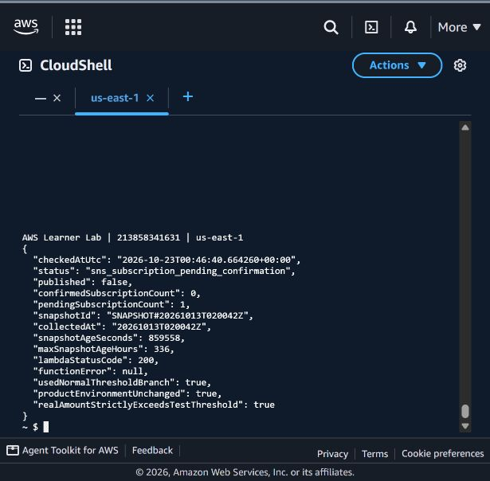
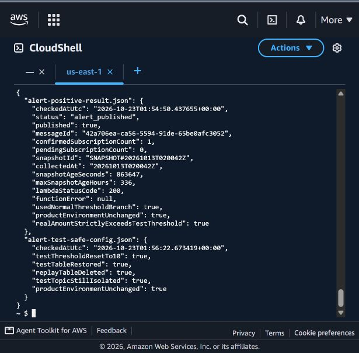

# Kiểm thử ngưỡng với hai trạng thái SNS — 23/10/2026

## Mục đích và dữ liệu thực

GVHD gợi ý bổ sung nhánh metric vượt ngưỡng và SNS subscription đã xác nhận, để đối chiếu với nhánh chưa xác nhận của tuần 3. Phép thử dùng Lambda `learnerlab-ops-week3-threshold-negative-test` và topic `learnerlab-ops-week3-negative-test`; Lambda sản phẩm `learnerlab-ops-week2-threshold-alert` giữ ngưỡng **10 USD**, cửa sổ độ mới **48 giờ** và topic sản phẩm.

Các snapshot gần đây không có số tiền dương phù hợp để thử ngưỡng dương thấp. Vì thế chọn snapshot thật `SNAPSHOT#20261013T020042Z`, `estimated=true`, kỳ 01/10 đến trước 14/10. Đã sao chép nguyên item từ DynamoDB sản phẩm sang bảng replay dùng một lần và đối chiếu item bằng nhau, không sửa số tiền, ngày hay thời điểm thu thập.

**Đây là replay dữ liệu lịch sử ngày 13/10, không phải minh chứng chi phí hiện tại vượt ngưỡng.** Snapshot này đã quá 48 giờ; chỉ Lambda thử được đặt cửa sổ **336 giờ (14 ngày)** và ngưỡng bằng một nửa tổng dương thực của snapshot. Cửa sổ và ngưỡng sản phẩm không đổi. [Unit test replay](../tests/test_replay_window.py) xác minh dữ liệu cũ bị từ chối với mặc định 48 giờ và chỉ được chấp nhận khi chỉ định cửa sổ thử riêng.

## Trước khi xác nhận subscription

Lúc 07:46:01 ICT, topic thử có **confirmed=0, pending=1**. Invoke Lambda thử lúc **07:46:40** với payload `{}`; kết quả:

- `lambdaStatusCode=200`, không FunctionError.
- `realAmountStrictlyExceedsTestThreshold=true`: dữ liệu thật đã vượt ngưỡng thử.
- `status=sns_subscription_pending_confirmation`, `published=false`.
- `confirmedSubscriptionCount=0`, `pendingSubscriptionCount=1`, không có `messageId`.

Hàm dừng trước bước SNS Publish. Subscription chưa xác nhận không bị hiểu nhầm là một kênh cảnh báo hoạt động.



## Sau khi xác nhận subscription

Lúc **08:54:50 ICT (01:54:50 UTC)**, sau khi xác nhận subscription có **1 confirmed, 0 pending**, đã gọi lại cùng Lambda thử với payload `{}`. Kết quả `alert_published`, `published=true`, `messageId=42a706ea-ca56-5594-91de-65be0afc3052`; Lambda trả `StatusCode=200`, không FunctionError. Snapshot thật đã vượt ngưỡng thử. Đây là nhánh xử lý ngưỡng bình thường, không dùng cờ `test:true` để bỏ qua điều kiện.

`messageId` xác nhận SNS đã nhận yêu cầu Publish; không tự chứng minh email đã vào hộp thư. Chỉ ghi nhận nhận được email khi người nhận xác nhận riêng.



Sau phép thử đã đưa Lambda thử về ngưỡng 10 USD, cửa sổ 48 giờ và bảng snapshot sản phẩm; topic vẫn là topic thử riêng. Bảng replay dùng một lần đã được xóa. Cấu hình ngưỡng/topic sản phẩm không đổi.

## Cách thực hiện

[Script kiểm thử SNS](../scripts/test_alert_delivery.py) kiểm tra account và tag, sao lưu mã/cấu hình thử, kiểm tra subscription trước Invoke, chỉ chạy mỗi pha gửi một lần khi chưa có tệp kết quả. Email được nhập bằng getpass, không in hoặc đưa vào evidence/repo. Mã guard dùng trong hai pha là [mã tuần 3](../../tuan_3/src/threshold-alert/lambda_function.py), SHA-256 `11e5e5867142fedc324460c699a6df75f7fefd34e25ff7cd34f13dad6000538e`.

Các thao tác CloudShell do LLM/AI ChatGPT thực hiện. Việc bấm liên kết xác nhận email thuộc người nhận; không suy đoán thao tác này từ thời gian đã chờ.


<details>
<summary>Kết quả lệnh đã lưu (chỉ các trường công khai)</summary>

```json
{
  "alert-plan.json": {
    "checkedAtUtc": "2026-10-23T00:45:21.406256+00:00",
    "snapshotId": "SNAPSHOT#20261013T020042Z",
    "collectedAt": "20261013T020042Z",
    "withinHistoricalReplayWindow": true,
    "estimated": true,
    "replayMaxAgeHours": 336,
    "productMaxAgeHours": 48,
    "sourceSnapshotWithinProduct48Hours": false,
    "sourceTable": "learnerlab-ops-week2-snapshots",
    "isolatedReplayTable": "learnerlab-ops-week4-billing-replay-test",
    "replayItemMatchesSource": true,
    "selectedSnapshotIsLatest": false,
    "periodStart": "2026-10-01",
    "periodEndExclusive": "2026-10-14",
    "thresholdMethod": "one half of the positive real snapshot amount, test Lambda only",
    "sourceSha256": "11e5e5867142fedc324460c699a6df75f7fefd34e25ff7cd34f13dad6000538e",
    "productEnvironmentUnchanged": true
  },
  "alert-subscription-state.json": {
    "checkedAtUtc": "2026-10-23T00:46:01.009466+00:00",
    "confirmed": 0,
    "pending": 1,
    "confirmationRequested": true
  },
  "alert-pending-result.json": {
    "checkedAtUtc": "2026-10-23T00:46:40.664260+00:00",
    "status": "sns_subscription_pending_confirmation",
    "published": false,
    "confirmedSubscriptionCount": 0,
    "pendingSubscriptionCount": 1,
    "snapshotId": "SNAPSHOT#20261013T020042Z",
    "collectedAt": "20261013T020042Z",
    "snapshotAgeSeconds": 859558,
    "maxSnapshotAgeHours": 336,
    "lambdaStatusCode": 200,
    "functionError": null,
    "usedNormalThresholdBranch": true,
    "productEnvironmentUnchanged": true,
    "realAmountStrictlyExceedsTestThreshold": true
  },
  "alert-positive-result.json": {
    "checkedAtUtc": "2026-10-23T01:54:50.437655+00:00",
    "status": "alert_published",
    "published": true,
    "messageId": "42a706ea-ca56-5594-91de-65be0afc3052",
    "confirmedSubscriptionCount": 1,
    "pendingSubscriptionCount": 0,
    "snapshotId": "SNAPSHOT#20261013T020042Z",
    "collectedAt": "20261013T020042Z",
    "snapshotAgeSeconds": 863647,
    "maxSnapshotAgeHours": 336,
    "lambdaStatusCode": 200,
    "functionError": null,
    "usedNormalThresholdBranch": true,
    "productEnvironmentUnchanged": true,
    "realAmountStrictlyExceedsTestThreshold": true
  },
  "alert-test-safe-config.json": {
    "checkedAtUtc": "2026-10-23T01:56:22.673419+00:00",
    "testThresholdResetTo10": true,
    "testTableRestored": true,
    "replayTableDeleted": true,
    "testTopicStillIsolated": true,
    "productEnvironmentUnchanged": true
  }
}
```

</details>
