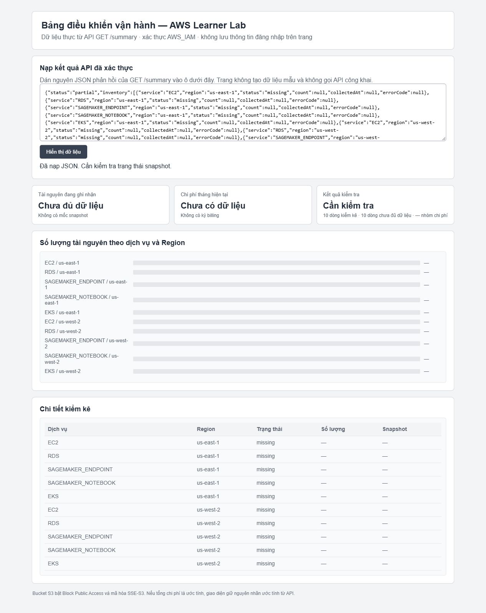

# Triển khai và kiểm thử giao diện S3 — 23/10/2026

## Lỗi và bản sửa

Giao diện cũ có thể cộng `count=null` thành 0 và vẫn cho kết quả tổng có vẻ đầy đủ. [Bản sửa dashboard](../../tuan_2/src/dashboard/index.html) chỉ nhận số lượng khi dòng có `status=ok` và count hợp lệ. Thiếu dữ liệu sẽ hiện dấu “—” trong bảng/biểu đồ, tổng hiện “Chưa đủ dữ liệu”; trạng thái kiểm tra có xét cả billing. Nếu JSON lỗi, giao diện xóa kết quả trước đó.

Lúc **07:51:21 ICT**, đã sao lưu HTML cũ rồi tải bản sửa lên bucket S3 sản phẩm. HTTP 200, nội dung tải lại khớp từng byte với repo; SHA-256 `2a4a5e0be8a7af4bbc11823c0add564ca51cbb1deb0d515320ea19346bb9fd8e`. Đủ bốn cờ Block Public Access vẫn bật, object dùng SSE-S3/AES256. [Script triển khai](../scripts/deploy_dashboard.py) giữ URL xem tạm và JSON billing ở ngoài repo.

## Kiểm thử trên trang S3 thật

Các thao tác nạp JSON/ấn nút được thực hiện trong trình duyệt; đọc lại nội dung DOM để so sánh, không sửa DOM để tạo kết quả.

| Trường hợp | Dữ liệu đầu vào | Kết quả |
|---|---|---|
| Snapshot đủ | Phản hồi thật của API ký SigV4 sau lần thu dữ liệu 23/10 | Tổng inventory khớp tổng count, health `OK`, 10 dòng; giá trị billing khớp JSON và giữ nhãn “ước tính”. |
| Không có snapshot | Phản hồi thật từ Lambda/bảng rỗng ở phép thử AWS | Tổng “Chưa đủ dữ liệu”, billing “Chưa có dữ liệu”, health “Cần kiểm tra”; 10 dòng có dấu “—”, không đổi thành 0. |
| JSON sai cú pháp | Chuỗi cố ý sai `{invalid-json` (đầu vào kiểm thử giao diện) | Hiện lỗi đọc JSON; các thẻ tổng và health trở về “—”; bảng không còn dòng cũ. |



Giao diện vẫn nạp thủ công JSON đã xác thực, theo lựa chọn giữ API `AWS_IAM`. Chưa có đăng nhập trình duyệt và cơ chế tự gọi API bằng SigV4. Không đưa credentials lên giao diện và không công khai route để hoàn tất phép thử. URL xem S3 có hạn chỉ dùng cho buổi kiểm tra, không phải link bàn giao lâu dài.

JavaScript vượt qua `node --check`. Các kiểm thử này do LLM/AI ChatGPT chạy; thời lượng sinh viên được ghi riêng trong worklog.

<details>
<summary>Kết quả đối chiếu giao diện và S3</summary>

```json
{
  "deployment": {
    "checkedAtUtc": "2026-10-23T00:51:21.495510+00:00",
    "bucket": "learnerlab-ops-week2-dashboard-213858341631",
    "sourceSha256": "2a4a5e0be8a7af4bbc11823c0add564ca51cbb1deb0d515320ea19346bb9fd8e",
    "putHttpStatus": 200,
    "objectMatchesRepo": true,
    "publicAccessBlockUnchanged": true,
    "encryption": "AES256"
  },
  "browser": {
    "checkedAtUtc": "2026-10-23T00:55:17.614Z",
    "valid": {
      "resourceTotalMatches": true,
      "healthIsOk": true,
      "billingMatches": true,
      "rowCount": 10,
      "estimatedLabelPreserved": true
    },
    "empty": {
      "billing": "Chưa có dữ liệu",
      "health": "Cần kiểm tra",
      "resourceTotal": "Chưa đủ dữ liệu",
      "rows": 10,
      "unknownCountCells": 10
    },
    "invalid": {
      "errorVisible": true,
      "tableRowsAfterError": 0,
      "totalsCleared": true
    }
  }
}
```

</details>
